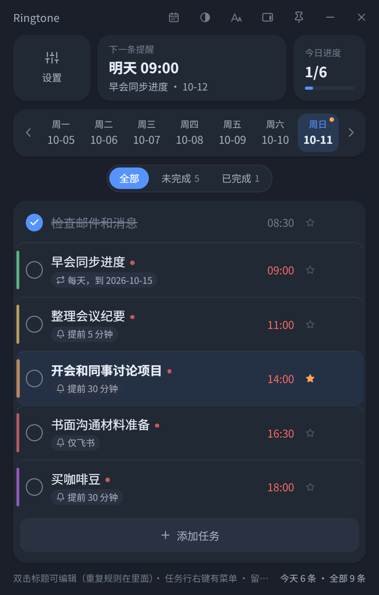
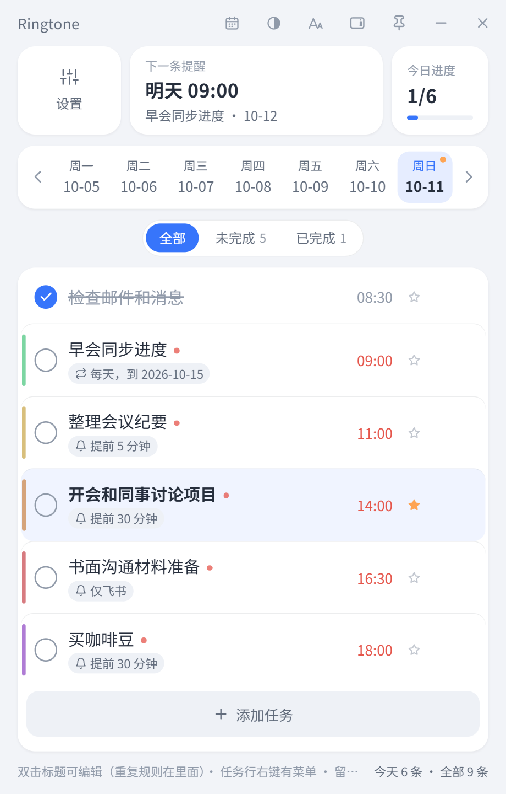
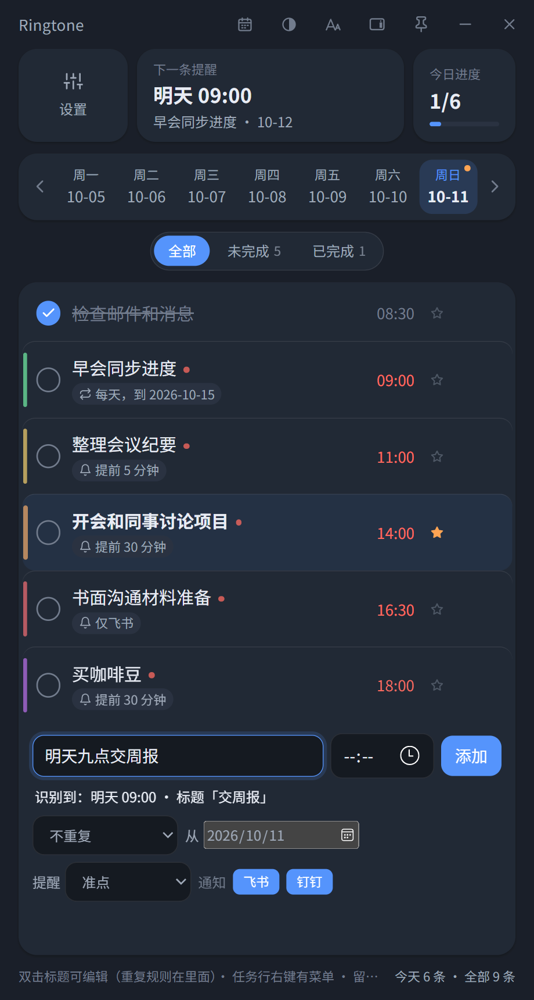
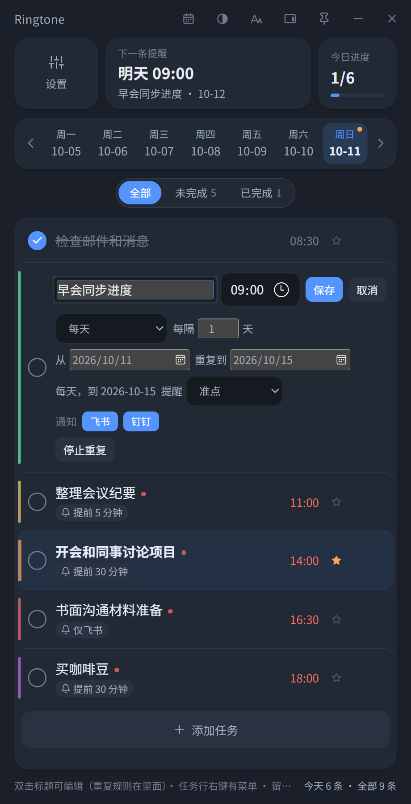
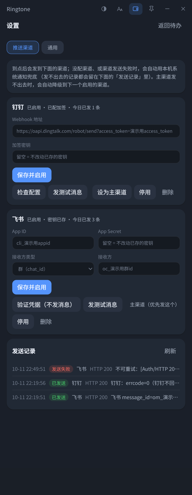
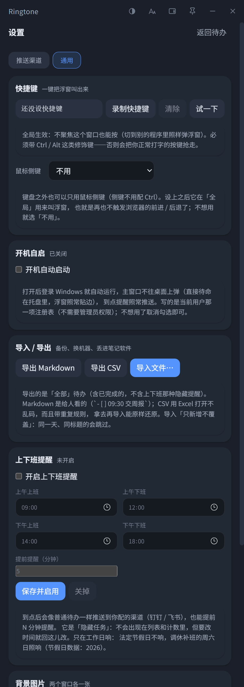
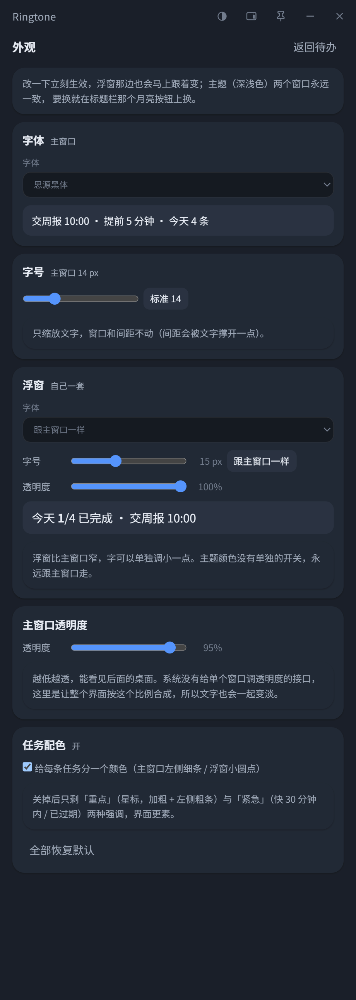
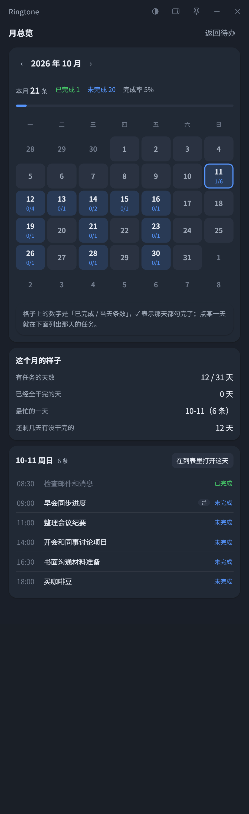
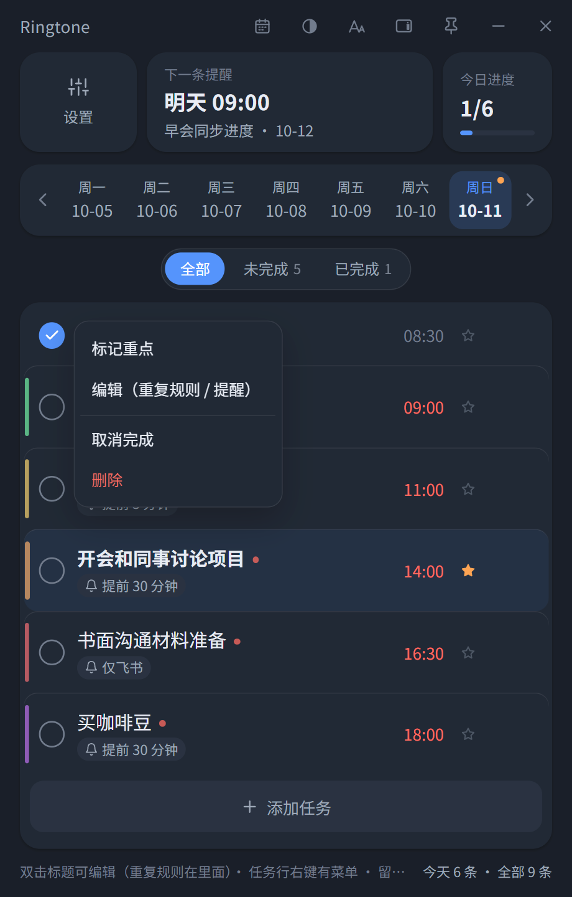

<div align="center">


# Ringtone

**本地优先的定时提醒 + 多平台推送桌面应用**

到点之后把提醒推到钉钉 / 飞书 / 微信（WxPusher）；关机不补发、发送失败会降级，数据只存在自己机器上。

[](https://github.com/cmacckk/Ringtone)
[](https://tauri.app)
[](https://react.dev)
[](https://github.com/cmacckk/Ringtone)
[](https://github.com/cmacckk/Ringtone)

</div>

> 对标 [Kite 待办](https://kite.kitlib.cn/) 的按天待办体验，补上它的缺口：**到点自动联动社交平台通知**。
> 只做单向推送（不接收回调）、只在自己机器上跑、不需要服务器和域名。

---

## ✨ 功能

- 🗓 **按天规划，离线可用** —— 460×720 窄竖窗，一周一条周条 + 卡片列表；SQLite 存在本机，不用登录、断网照常用。
- ⏰ **到点真的会提醒你** —— 到点把「时间 + 标题 + 备注」推到**钉钉 / 飞书 / 微信（WxPusher）**；主渠道发失败自动降级到下一个渠道，全挂了用本机系统通知兜底，并留一条失败记录。
- 🔁 **重复规则** —— 每天 / 工作日 / 每周（可多选星期几）/ 每月 / 每月最后工作日 / 每年，支持「**从 2026-10-13 重复到 2026-10-15**」这样的日期区间，起始日随时能改。
- 🇨🇳 **认中国节假日** —— 「工作日」与「每月最后工作日」内置 2026 年国务院安排：法定节假日不响、**调休补班的周六日照响**；「每月 31 日」在 2 月自动落到 28/29 日，不会整月不响。
- ✍️ **中文快捷录入** —— 输入框里写 `明天九点交周报`、`每周一三五交周报`、`10/20 交报告`、`每月最后一个工作日 巡检机房`，实时显示识别结果，回车即成任务。
- 🔔 **提前提醒** —— 准点 / 提前 1、5、10、30 分钟 / 1 小时 / 1 天。
- 💬 **提醒渠道按任务选** —— 有的任务只想发钉钉、有的只想发飞书、有的只想发微信，逐条可设；只勾一个渠道时失败了就本地兜底，**不会偷偷发到另一个渠道**。
- 🪟 **贴边浮窗** —— 主窗口最小化后贴在屏幕边缘，鼠标移过去展开；浮窗里能直接勾完成、能拖动换边、字体字号透明度可单独调，永远在最前面。
- ⚡ **一键叫浮窗** —— 全局快捷键（默认未设，示例 `Ctrl+Shift+X`）或**鼠标侧键**，在任何程序里都能按。
- 🚀 **开机自启** —— 登录后直接待命在托盘里，主窗口不往桌面上弹，到点照样推。
- 🕘 **上下班提醒** —— 填四个时间点（上午/下午上下班）+ 提前多少分钟，界面顶部显示「距离下班还有 8 分 1 秒」。
- 📤 **导入导出** —— 导出 Markdown（给人看）和 CSV（给 Excel 看，带 BOM）；再导入能原样还原重复规则与提前提醒，**只新增不覆盖**。
- 🎨 **看着舒服** —— 深/浅主题、六款中文字体、字号 12~20px、窗口透明度、背景图、任务配色（8 色低饱和，已完成的不上色）、重点星标（加粗 + 粗色条，不进排序）。
- 📊 **月总览** —— 一个月一张网格：每格「已完成 / 当天条数」，全干完的偏绿、没干完的偏蓝；点某天就地列出那天的任务。
- 🖱 **三层右键菜单** —— 任务行（重点 / 编辑 / 完成 / 删除）、日期格（在那天加任务 / 跳过去 / 从剪贴板新建）、留白（加任务 / 显示浮窗 / 设置 / 总览 / 收进托盘）。

---

## 📸 截图

> 下面全部是**演示数据**（假渠道、假待办），深浅两套都有，浅色见 `-light.png`。

### 主界面

 

顶部三格是「设置 / 下一条提醒 / 今日进度」，中间周条（右上角橙点 = 那天有安排），下面是当天的任务：
左侧彩条是任务标识色，`↻` 是重复规则、`🔔` 是提前提醒，红色时间 = 快到点了，★ = 重点。

### 中文快捷录入



写 `明天九点交周报`，下面立刻显示 `识别到：明天 09:00 · 标题「交周报」`；同一行还能设重复规则、提醒点、发到哪个渠道。

### 编辑任务（重复规则 / 提醒 / 渠道）



双击标题进编辑态：改标题与时刻、改重复规则（这里是「每天，从 2026/10/11 重复到 2026/10/15」）、提前提醒、通知渠道，以及「停止重复」。

### 推送渠道



钉钉与飞书两张卡：「检查配置 / 验证凭据」「发测试消息」「设为主渠道」「停用 / 启用」「删除」；下面是发送记录（成功写渠道侧 `message_id`，失败写 HTTP 状态与原始错误码）。

### 通用设置



快捷键、开机自启、导入导出、上下班提醒、背景图片。

### 外观



字体 / 字号（主窗口一套、浮窗可单独一套）、主窗口与浮窗各自的透明度，改一下立刻生效、不用保存。

### 月总览



本月合计 + 完成率、一个月网格、这个月的统计，以及**就地**列出选中那天的任务。

### 右键菜单



### 贴边浮窗


主窗口最小化后贴在屏幕边上，显示今天最多 5 条（含已完成的）；点圆圈直接勾完成，点一下打开主窗口，拖一下换到另一条边。

---

## 📦 安装

**安装包（Windows 10 1803+ / Windows 11）**

**[⬇ 下载 Ringtone_0.1.0_x64-setup.exe](https://github.com/cmacckk/Ringtone/releases/download/v0.1.0/Ringtone_0.1.0_x64-setup.exe)** · [releases 页面](https://github.com/cmacckk/Ringtone/releases)

```text
Ringtone_0.1.0_x64-setup.exe        4.65 MiB（NSIS，当前用户安装，不需要管理员）
SHA256  ec860b9606303aa15aa24ecfee0b2bca9913bfbeb5fdd8f8fd508cba26d77156
```

- 依赖 **WebView2**：Win11 与较新的 Win10 自带；没有的话装一次微软的 Evergreen Runtime 即可。
- 安装包**没有代码签名**，SmartScreen 会拦一下：点「更多信息」→「仍要运行」。
- 卸载走系统「应用和功能」，卸载**不会**删掉 `%APPDATA%\cn.ringtone.desktop` 里的数据库（想彻底清就手动删这个目录）。

**从源码跑起来**

```bash
# 需要 Node 20+ / pnpm、Rust stable、VS Build Tools（C++ 桌面开发）
pnpm install
pnpm tauri dev            # 开发窗口（vite + cargo run）
pnpm tauri build          # 打 Windows 安装包（NSIS）
```

---

## ⌨️ 快捷键

| 按键 | 作用 |
| --- | --- |
| `回车` | 录入框里添加任务 |
| `Esc` | 收起录入框 / 取消编辑 / 关右键菜单 |
| `双击标题` | 进入编辑（重复规则 · 提醒点 · 通知渠道） |
| `右键` | 菜单（任务行 / 日期格 / 留白，见上面截图） |
| 全局热键（默认未设，示例 `Ctrl+Shift+X`） | 在任何程序里一键叫出浮窗 |
| 鼠标侧键 `4` / `5`（设置里开启） | 同上，键鼠都不用切窗口 |

> 全局热键**必须带 Ctrl / Alt 这类修饰键**（不然会把你正常打字的按键抢走）；被别的程序占用时设置里会直接说出原因。
> 鼠标侧键是自写的 Windows 低级鼠标钩子，**设上之后它在全局用来叫浮窗，不再触发浏览器的前进 / 后退**。

---

## 🧱 技术栈

| 层 | 用了什么 | 为什么 |
| --- | --- | --- |
| 外壳 | **Tauri 2**（Rust） | 对标产品安装包只有 3.72 MB ⇒ 体积敏感；Electron 起步 80 MB+ |
| 前端 | **React 19 + TypeScript（strict）+ Vite** | 组件化 + 类型检查；Vite 常驻开发体验好 |
| 存储 | **SQLite（rusqlite，bundled 编译）** | 单文件、无外部依赖，编译进二进制，用户不用装任何东西 |
| 时间 | **chrono**，全部 `Local` 时区 | 跨天、跨休眠的语义要自己写清楚 |
| 原生能力 | tray-icon / notification / global-shortcut / autostart / dialog | 托盘常驻、系统通知兜底、全局热键、开机自启、选文件 |

---

## 🚀 快速开始

```bash
pnpm install          # 首次
pnpm tauri dev        # 起开发窗口（vite + cargo run）
pnpm tauri build      # 打 Windows 安装包（NSIS）
```

**交付前必跑（四条，缺一不可）：**

```bash
cd src-tauri
cargo fmt --check
cargo check
cargo clippy --all-targets
cargo test            # 当前 146 passed
```

```bash
pnpm exec tsc --noEmit
pnpm build
```

> `cargo check` **不编译 `#[cfg(test)]` 代码**：改了函数签名后 check 会过，而 `cargo test` 会因为测试里的调用点坏掉而编不过。

---

## 📁 项目结构

```text
Ringtone/
├─ src/                        前端（React + TS）
│  ├─ App.tsx                  待办页：周条 + 列表 + 录入 + 编辑 + 筛选 + 计数
│  ├─ TitleBar.tsx             自绘标题栏（主题 / 外观 / 浮窗 / 置顶 / 最小化 / 收托盘）
│  ├─ Float.tsx                贴边浮窗（轮询、展开收起、拖动换边、勾完成、右键菜单）
│  ├─ Overview.tsx             月总览
│  ├─ Settings.tsx             设置面板外壳（推送渠道 / 通用 两个页签）
│  ├─ Prefs.tsx                通用设置（快捷键 / 开机自启 / 导入导出 / 上下班 / 背景图）
│  ├─ AppearancePanel.tsx      外观（字体 / 字号 / 透明度）
│  ├─ Repeat.tsx               重复规则编辑器
│  ├─ Advance.tsx / Notify.tsx 提前提醒 / 通知渠道选择
│  ├─ ContextMenu.tsx          自绘右键菜单
│  ├─ quick.ts                 中文快捷录入解析
│  ├─ day.ts / time 相关        日期工具（**不用 `toISOString()`**，见设计约定）
│  ├─ api.ts                   invoke 封装与类型（字段与 Rust 一致）
│  ├─ appearance.ts / theme.ts / colors.ts / sync.ts / photo.ts
│  └─ styles.css               全部样式（深/浅两套变量 + 43 处字号走 `--fs-k`）
├─ src-tauri/                  后端（Rust）
│  ├─ src/lib.rs               入口：建窗口/托盘、窗口事件、命令注册、调度线程
│  ├─ src/db.rs                迁移（清单驱动）+ 任务/实例/渠道/队列/日志的读写
│  ├─ src/scheduler.rs         到点调度（网格对齐 tick + 错过语义 + 幂等）
│  ├─ src/deliver.rs           投递、退避重试、降级链、限流、本地兜底
│  ├─ src/channel/             渠道实现（dingtalk.rs / feishu.rs / wxpusher.rs + 错误分类）
│  ├─ src/work.rs              上下班提醒（隐藏任务）  src/holiday.rs 法定节假日
│  ├─ src/port.rs              导入导出            src/background.rs 背景图
│  ├─ src/mouse.rs             鼠标侧键钩子         src/models.rs / time.rs 校验
│  └─ tauri.conf.json / capabilities/default.json / icons/
├─ scripts/
│  ├─ shot.mjs                 CDP 截图（深/浅两套，可先点按钮再截）
│  └─ publish-release.ps1      建 GitHub release 并上传安装包
└─ docs/                       方案与每个里程碑的报告
```

---

## 📊 里程碑与当前状态

| 里程碑 | 内容 | 状态 |
| --- | --- | --- |
| M1 | 任务 CRUD + 按天视图 + SQLite 落库 + 托盘常驻 | ✅ 完成 |
| M2 | 到点调度（occurrences 幂等 + 补发窗口 + 休眠唤醒补偿） | ✅ 完成 |
| M3 | 飞书渠道打通（自建应用 + 错误分类 + 失败兜底） | ✅ 完成 |
| M4 | 钉钉渠道 + 投递队列 + 降级链 + 限流闸门 | ✅ 完成 |
| M5 | 界面改造（kite 风格：自绘标题栏 + 信息块 + 周条 + 卡片列表，深/浅两套主题） | ✅ 完成 |
| M6 | 打磨：重复规则、快捷录入、提醒渠道选择、主题 / 筛选 / 浮窗、外观设置、月总览、浮窗勾选、通用设置（快捷键 / 开机自启 / 导入导出 / 上下班提醒 / 背景图）、交互与观感第二批（右键菜单 / 重点 / 配色 / 鼠标侧键 / 多屏落点）、空白处右键菜单、节假日感知（工作日 / 月末对齐 / 每月最后工作日）、重复任务的日期区间（从哪天到哪天）、微信推送（WxPusher）渠道、字体可选全部系统字体、打包分发 | 🔄 进行中（上面列的都已 ✅，只剩安装包分发；密钥加密用户明确不做） |

核心链路（M1–M4）：

- 按天列出任务，时间升序、**无时刻的排在最后**；
- 新建 / 编辑 / 勾选完成 / 删除（删除只接受明确 id 列表）；
- 关窗不退出，驻留系统托盘（托盘菜单：显示主窗口 / 退出）；
- 到点触发：**先发主渠道，失败按错误类型退避重试或换下一个渠道，全失败才用本机系统通知兜底**；
- 投递走队列（`push_jobs`），退避重试不会拖住其它提醒，重启后也知道哪些没发完；
- 限流闸门：钉钉 20 条/分、飞书 100 条/分、WxPusher 10 条/分，超限**推迟**而不是硬发（不给渠道封禁的机会）；
- 失败可见：托盘换红点 + tooltip `Ringtone · N 条提醒发送失败`，界面右上角 `⚠ N 条没发出去`（点「知道了」清除）；
- 渠道范围：**钉钉 + 飞书 + 微信（WxPusher）**（Server 酱免费版只显示标题、PushPlus 未实名额度为 0，都不做）。

---

## 配置推送渠道（钉钉）

1. 钉钉群 → 群设置 → 智能群助手 → 添加机器人 → 自定义（webhook）机器人；
2. 安全设置勾**加签**，把密钥（`SEC` 开头）和 Webhook 地址各拿一份；
3. 应用里点「设置 → 推送渠道」，粘 Webhook 地址 + 加签密钥，保存并启用；
4. 点「发测试消息」，群里应收到一条 `【Ringtone 测试】`。

发消息：`POST https://oapi.dingtalk.com/robot/send?access_token=<你的access_token>`（带 `timestamp` 与 `sign`）。

- **上限是每个机器人 20 条/分钟，超了会被封 10 分钟**。这是所有渠道里最硬的一条限制，Ringtone 用滑动窗口拦着，
  到上限的那条会推迟到窗口滑出再发（推迟不算一次失败尝试）。
- 钉钉的业务错误几乎都是 **HTTP 200 + `errcode != 0`**，只看 HTTP 状态码判断不了成败。
- 签名错时钉钉回 `errcode=310000`，界面上会提示「检查密钥 / 系统时间」或「机器人安全设置要关键词」。
- **钉钉没有「只验证不发消息」的接口**，所以钉钉卡片的「检查配置」只做格式校验（飞书那张是真取 token）。

## 配置推送渠道（飞书）

1. 飞书开放平台建一个**企业自建应用**，记下 `App ID` 与 `App Secret`；
2. 开通权限 `im:message`（或 `im:message:send_as_bot`），把机器人拉进目标群；
3. 取群的 `chat_id`：`GET https://open.feishu.cn/open-apis/im/v1/chats`（带 `Bearer <tenant_access_token>`）；
4. 应用里点「设置 → 推送渠道」，填 `App ID` / `App Secret`，接收方类型选「群（chat_id）」、粘 `oc_` 开头的值，保存并启用。

取 `tenant_access_token`：`POST https://open.feishu.cn/open-apis/auth/v3/tenant_access_token/internal`；
发消息：`POST https://open.feishu.cn/open-apis/im/v1/messages?receive_id_type=chat_id`。

几个容易踩的点：

- **自定义机器人（webhook）只能发群**，而且限制更严（100 次/分、5 次/秒）；
  自建应用既能发群也能发单聊（`receive_id_type` 改成 `email` / `open_id` / `user_id`）。
- 发单聊需要该用户能看到这个应用（需企业管理员授权范围），发群只需要机器人已在群里。
- `app_secret` 只存在本机 SQLite，**不回传前端、不写日志**；界面只显示「密钥已存 / 未填」。

## 配置推送渠道（微信 · WxPusher）

[WxPusher](https://wxpusher.zjiecode.com/) 是把消息推到你**微信**里的中转服务（关注一个公众号就能收）。
适合「不想把机器人拉进群、只想自己收到」的场景。

1. 去 <https://wxpusher.zjiecode.com/> 用微信扫码登录，建一个应用，拿 **appToken**（`AT_` 开头）；
2. 让接收人（你自己）用微信关注该应用的二维码，在「我的」里拿到 **UID**（`UID_` 开头）；
3. 应用里点「设置 → 推送渠道 → 微信推送（WxPusher）」，填 UID 与 appToken，保存并启用；
4. 点「发测试消息」，手机上应该收到一条 `【Ringtone 测试】`。

发消息：`POST https://wxpusher.zjiecode.com/api/send/message`（`Content-Type: application/json`），
请求体形如 `{"appToken":"AT_xxx","content":"...","summary":"...","contentType":1,"uids":["UID_xxx"]}`。

几个容易踩的点：

- **appToken 是密钥**（能往你的微信发消息），只存在本机 SQLite，不回传前端；界面上只显示「appToken 已存 / 未填」。
  不公开 demo 里的那份必须是假的。
- 能填**多个 UID**（逗号 / 空格隔开），最多 20 个；`summary` 官方限 20 个字符，超了会整条报错，Ringtone 会自动按字符截。
- 官方限制：**接口 QPS ≤ 1**（所以这里按 10 条/分 发，提醒是稀疏事件够用）、单个 UID 每天 ≤ 2000 条。
- 业务错误一律 `HTTP 200 + code`：`1000` 成功、`1002` appToken 无效、`1001` 通用业务错误
  （实测 appToken 写错也回 `1001 appToken不正确`，所以别指望靠 code 区分，要看服务端的 `msg`）。
- WxPusher **没有「只验证不发消息」的接口**，卡片的「检查配置」只做格式校验（`AT_` / `UID_` 前缀、数量），
  真想确认只能点「发测试消息」。

## 推送失败时会怎么走（降级规则）

| 错误类型 | 例子 | 行为 |
| --- | --- | --- |
| `Retryable` | 网络不通、超时、HTTP 5xx | **同渠道**退避重试，等 5s → 30s → 2min，共 4 次机会 |
| `QuotaExceeded` | 撞限流、额度用尽 | **立刻换下一个渠道**（再试会被封更久） |
| `Auth` | 凭证失效（飞书 `10014`、钉钉 `300005`） | **立刻换下一个渠道** |
| `BadRequest` / `Config` | 参数错、配置缺失 | **立刻换下一个渠道** |

渠道尝试顺序 = 「已启用」的渠道按 `priority` 升序（界面上的「设为主渠道」就是调这个）；
所有渠道都失败 → 本机系统通知兜底 + 托盘红点 + 界面角标 + 写 `send_log`。

**错过语义（有意为之）**：App 没运行时（关机、没登录）错过的提醒**一律标 `missed`、不补发**——
它的意义就是「人不在电脑前也能收到」，事后补发一串翻旧账的通知比不补更糟。只有一种例外：
机器休眠后唤醒（tick 间隔 > 90s）且过期不超过 30 分钟的实例会补发，并在记录里标成 `late_sent`。

## 重复规则

双击标题 → 编辑器第二行就是重复规则；添加任务的第二行也能直接设。

```text
频率：不重复 / 每天 / 工作日 / 每周 / 每月 / 每月最后工作日 / 每年     每隔 [1] 天
每周时：一二三四五六日（点一下选中/取消；不选 = 跟起始日同一个星期几）
从 [yyyy/mm/dd]     重复到 [yyyy/mm/dd]（留空 = 一直重复，填了含当天）
```

- **「从」+「重复到」= 一个日期区间**：例如从 `2026-10-13` 重复到 `2026-10-15`，这三天里每天都会出现在当天的列表里
  （结束日**含**当天，10-16 就没有了）。只选频率不填「重复到」就是一直重复。
- **起始日随时能改**：编辑器里的「从 yyyy/mm/dd」就是这条任务的起始日（重复任务 = 系列的第一天），
  改完保存后视图会跟着跳到那天。改了起始日，`每月 8 日` / `每年 3 月 5 日` 这种也等于把系列挪了起点。
- **「工作日」和「每月最后工作日」看中国法定节假日**：内置 2026 年国务院安排（含调休补班的周六日），
  法定节假日不响、补班的周末照响；没有那一年的数据时退化成「周一至周五」，界面上会提示数据覆盖到哪几年。
- **「每月」做月末对齐**：`31 号` 的规则在 2 月落 28/29 日、4 月落 30 日，不会因为当月没 31 号就整月不响。
- **勾选 = 完成本次，系列继续**；真的不想再重复了，编辑器里点「停止重复」（任务和已勾过的记录都留着）。
- 展开的范围：每次 tick 为未来 7 天生成提醒实例，所以关机几天再开也能接上；不会一次生成几年的数据。

## 提前提醒

「准点 / 提前 1、5、10、30 分钟 / 1 小时 / 1 天」，就在重复规则下拉的同一行（添加任务、双击编辑都能设）。

- 存的是相对到点时刻的**秒偏移数组**（`[-300,0]` = 提前 5 分钟 + 到点），列表上显示成 `提前 5 分钟` 标签。
- 接口传 `remind_offsets: null` 在**更新**时表示「别动库里已有的提醒点」——界面没碰那个下拉时就是这个行为，
  不会把用户存的多个提前点静默压成「准点」。
- 界面只给固定几档；库里存的是多个提前点等认不出来的形状时，下拉显示「保持原样」，保存时原值不动。

## 快捷录入

添加任务的输入框里直接写一句中文就能把日期、时刻、重复一起定下来：

```text
明天九点交周报        → 10-09 09:00，标题「交周报」，视图自动跳到 10-09
下下周三交材料        → 10-28（「下」+7 天，「下下」+14 天）
10/20 交报告          → 10-20（斜杠日期，只认斜杠：`3.5` 这类不会被当成日期）
每月最后一个工作日 巡检 → 每月最后一个工作日（跳过法定节假日与周末）
每周一三五交周报      → 每周一、三、五
每周二、四晚上八点健身 → 每周二、四 20:00
下午3:30开会          → 15:30
每天九点喝水          → 每天 09:00
今天九点…             → 提示「时间已过去，不会提醒」（后端记成错过，不补发）
```

- 输入框下面实时显示 `识别到：明天 09:00 · 标题「交周报」`，**先看再回车**；
- 认不出来就当普通标题，**不猜**（`下午` 后面没有数字就不动；`25点`、`9点70分` 也不修正）；
- 认到的片段会从标题里摘掉；摘成空就退回原文，不会存出一条没标题的任务；
- 文字里的时间优先于手动填的时间框（提示行显示的是实际生效的那个）。

支持的写法、30 条验证用例、两个首测抓到的 bug 都在 `docs/M6-quick-report.md`。

## 提醒渠道选择

每条任务可以限定「只发到哪个渠道」，开关就在重复规则下拉的同一行（添加任务、双击编辑都有）：

- 全开 = **全部启用渠道**（跟以前一样，存 `null`）；只开一部分 = 只发这些（存 `["dingtalk"]` 这样的类型列表）。
- 存的是渠道**类型**，不是渠道 id —— 渠道删了重建、id 变了也照样对得上。
- **至少留一个**：全关等于「一条都不发」，没这个选项，所以最后一个点不动。
- **降级只在勾选的渠道里降**：选了「只发钉钉」而钉钉挂了，不会再偷偷发到飞书——这时走本机通知兜底 +
  记一条失败（顶部会出现红点提示），因为用户明确说了只要这一个。
- 只配了一个渠道时开关不显示（没得选）；选过的渠道后来被停用时，列表标签会注明「已停用，走本机通知兜底」。
- 列表行上显示 `仅钉钉` 这类标签；不限定渠道的任务不显示标签。

## 月总览

标题栏的**日历按钮**（主题按钮左边），或者直接点顶部「今日进度」那块，都能打开：

- 一个月一张网格（周一开头，固定 6 行）：每格写「已完成 / 当天条数」，`✓` = 那天都勾完了；
  还有没干完的那天底色偏蓝、全干完的偏绿；今天和「正在看的那天」有描边。
- 点某一天 → **就地**选中它，并在下面那张卡里列出那天的任务（面板不关）；想跳到完整列表（能编辑、能勾）
  就点卡片右上角的「在列表里打开这天」。
- 顶部是本月合计（条数 / 已完成 / 未完成 / 完成率 + 进度条），`‹` `›` 翻月，看别的月时有「回到本月」。
- 下面一张卡：有任务的天数、已经全干完的天数、最忙的一天、还剩几天有没干完的；
  再下面一张卡是**选中那天**的任务清单（时间 / 标题 / 重复标记 / 已完成未完成）——默认选中的是正在看的那天。
- 数字跟周条、页脚**同一个口径**（后端按天展开重复任务算出来的），补白格子（上/下个月的日期）不计入统计。

## 外观设置（字体 / 字号 / 窗口透明度）

标题栏置顶按钮左边的 `Aa` 按钮，点开是一整屏的外观面板（返回待办的按钮在右上角）：

- 面板分四块：**字体（主窗口）**、**字号（主窗口）**、**浮窗**、**主窗口透明度**。
- **字体**：下拉里是**本机已安装的全部字体**（后端读 Windows 注册表的字体表，这台机器上 215 个；
  按字母排序，也能选「自己填…」手写 `font-family`）。存的只是**字体家族名**（如 `KaiTi`），
  写进 CSS 时自动补引号并叠一条系统字体做回退 —— 字体被卸了也不至于变成浏览器默认的那种弱字体。
- **字号** 12~20 px（默认 14）。标题栏右边会实时显示当前 px。
- **浮窗**那块是**自己一套**：字体下拉里有「跟主窗口一样」（默认，存 `null`）、字号滑条 + 一键「跟主窗口一样」、
  浮窗自己的透明度。浮窗比主窗口窄，字可以单独调小一点（实测浮窗调成 12px 时主窗口仍是 14px）。
- **透明度**分主窗口、浮窗两条（50%~100%），各管各的。
- 改一下立刻生效，**没有「保存」按钮**；另一个窗口会马上跟着变（靠 `localStorage` 的 `storage` 事件）。
  最下面一条是「全部恢复默认」。
- **主题（深浅色）没有单独的开关**：两个窗口永远一致，要换就在标题栏那个月亮按钮上换。

几条实现上的实话（用起来会感受到）：

- **透明度是整体合成**：Tauri 的 window 插件没有 `setOpacity`（`core:window:allow-set-opacity` 不存在），
  所以做法是窗口 `transparent(true)` + `body { opacity: var(--win-opacity) }`。
  **文字会跟着一起变淡**，这是能力的边界，不是 bug。
- 界面底色**不能**画在 `body` 上：根元素没有背景时浏览器会把 `body` 的背景「传播」成画布背景，
  那一层不吃 `body { opacity }`，结果就是「界面淡了、桌面没透出来」。底色现在画在 `.app` 上。
- **字号只缩放文字、不动间距**：43 处 `font-size` 全部写成 `calc(Npx * var(--fs-k, 1))`，间距还是 px，
  所以字变大时间距会被文字撑开一点。
- 浮窗那边只吃「字体 / 字号 / 浮窗透明度」三项，面板里改完它马上就变（不用重开窗口）。

## 主题 / 筛选 / 浮窗

- **主题**：自绘标题栏上（置顶按钮左边）有个主题按钮，点一下在「跟随系统 → 亮色 → 深色」里轮换，
  选择记在 `localStorage`（`ringtone.theme`），下次启动照旧。亮色颜色只在 `:root[data-theme="light"]`
  和自己的 `@media (prefers-color-scheme: light)` 里各写一份 —— **改一份要改两份**，两处内容必须一致。
- **筛选**：周条下面一排「全部 / 未完成 / 已完成」，默认**全部**，后两个各带一个数字角标。
  它只影响列表显示；底部计数与今日进度始终是「今天」的真实数字，不随筛选变。
- **底部计数**：`今天 N 条 · 全部 M 条`。「今天」与今日进度同源（后端 `count_by_day`，含重复任务的展开），
  「全部」是 `SELECT COUNT(*) FROM tasks`（1 条重复任务算 1 条，不按展开算），走单独的 `task_stats` 命令。
- **贴边浮窗**（第二个窗口 `float`）：主窗口最小化或收进托盘时出现（也可以用标题栏那个浮窗按钮手动
  显示 / 隐藏），按**浮窗自己所在那块屏**的右边缘对齐（`float_set_side("left" | "right")` 可换边）；
  展开 6 秒后自动收起，只留一条 9px 宽的边；鼠标移上去展开、移开 2.5 秒再收起。
- **右键菜单**：任务行右键四个动作（标记 / 取消重点、编辑、标记 / 取消完成、删除），浮窗条目右键三个
  （完成、重点、打开主窗口）。菜单是自绘的 `fixed` 层，位置会自己在窗口内夹住；点外面 / Esc / 窗口尺寸变都会关。
- **重点与配色**：任务行右侧星标按钮（或右键）标重点——标题加粗 + 色条变粗，**只管显眼，不进排序、不影响提醒**；
  色条颜色按任务 id 从 8 色低饱和色板固定分配（已完成的不画），时间颜色表示紧急度（过期深红、30 分钟内红 + 小圆点）。
  不想看颜色就去 设置 → 外观 → 关掉「任务配色」。
- **鼠标侧键**：设置 → 通用 → 「鼠标侧键」可以把侧键 4 / 5 设成「一键叫浮窗」（全局生效、且不再触发浏览器前进 / 后退）。
  默认关。这是自写的 Windows 低级鼠标钩子（`src-tauri/src/mouse.rs`），装不上只影响这一个功能，不挡启动。
- **浮窗能直接勾完成**：每行左边一个小圆圈，点一下就是「完成这次」，再点一下取消。
  已完成的也留在列表里（最多 5 行），不然勾完就消失、想撤销都点不到。
  勾完**主窗口的列表会跟着变**（浮窗往 `localStorage` 写一个 `ringtone.tasksPing`，主窗口收到 `storage` 事件重新拉一次）。
- **拖一下换边**：按住卡片左右拖，松手后吸附到最近的那条边（按**浮窗所在那块屏**的边界与缩放算），
  位置记在 `localStorage`（`ringtone.floatSide` / `ringtone.floatY`），下次还是那条边。
  点一下（不拖）还是打开主窗口。拖动是手写的 pointer 拖动（按下即停掉滑动动画、`setPointerCapture`、
  同一时刻只允许一次「读光标 + 摆窗口」），不是等 `onMoved` 去抖——后者看起来一顿一顿。
- 浮窗内容 = 「今天 X/Y 已完成 · 全部 N 条」+ 今天最多 5 条（含已完成的）+ 「今天 N 条 · 点这里打开主窗口」。
  字体 / 字号 / 透明度都能单独设（见上一节），主题永远跟主窗口走。

坐标系上的两个坑（改浮窗之前先看这段）：

1. **全程用物理像素**（`PhysicalPosition`）。这台机器几块屏缩放不同（150% / 100%），而 Tauri 早期的
   `window.scale_factor` 给过错的数字——每块屏的真实缩放用**显示器自己报的** `monitor.scale_factor()`
   （实测 2560×1600 那块报 1.5、1920×1080 那块报 1.0，都准），窗口尺寸直接按
   `FLOAT_W / FLOAT_H × scale` 算（浮窗无边框、不可缩放，外框 = 内容）。只要过一次「逻辑像素」换算，
   窗口就会跑到屏幕外面。
2. **落点要按浮窗自己那块屏算，并缓存原始屏幕信息**。`float_dock()` 里先 `dock_monitor`（用浮窗自身位置
   `monitor_from_point`，取不到才退回主窗口所在屏 → 主屏），再 `dock_from(base, side)` 算贴边坐标。
   缓存的 `LAST_BASE` 存的是**原始屏幕信息**（屏边界、缩放、窗口尺寸）而不是算好的 x，这样主窗口最小化时
   换边也算得出来。主窗口一最小化，Windows 把它挪到 (-32000, -32000)，这时 `current_monitor()` 返回的是
   一块 `size = 0` 的假显示器（算出来 y = 0、x 乱飘）——读到 size 为 0 宁可报错也不覆盖缓存。

验证这类坐标别用 PowerShell 5.1：它是 DPI-unaware，`GetWindowRect` 的返回值会被缩放（实测把
(2546, 416) 报成 (3819, 624) = × 1.5），看起来像代码错了。权威读数是窗口自己报的
`outer_position()`（`__TAURI_INTERNALS__.invoke("plugin:window|outer_position", { label: "float" })`）。

## 右键菜单

菜单分三层：**任务行 / 条目**（改这一条）、**日期格子**（改这一天）、**留白**（全局动作）。

| 在哪右键 | 能干什么 |
| --- | --- |
| 任务行 | 标记 / 取消重点 · 编辑（重复规则 / 提醒）· 标记 / 取消完成 · 删除 |
| 浮窗条目 | 标记 / 取消完成 · 标记 / 取消重点 · 打开主窗口 |
| 周条或月总览的日期格 | 在 `10-09` 添加任务 · 跳到 `10-09`（当前就在那天时不出现）· 从剪贴板新建任务 |
| 主界面留白 | 添加任务 · 从剪贴板新建任务 · 显示 / 隐藏浮窗 · 设置 · 总览 · 收进托盘 |
| 浮窗空白处 | 添加任务（打开主窗口写）· 从剪贴板新建任务 · 打开主窗口 · 设置（打开主窗口） |

- **从剪贴板新建**：剪贴板里放 `明天九点交周报`，右键就能变成任务（走的是快捷录入那套解析）。
  只取第一行非空文字；落在别的日子时主窗口会自己切过去。
- **收进托盘**走的是 Rust 命令 `hide_main`（`hide()` + `sync_float()`），所以和标题栏 ✕ 一样：主窗口藏起来、
  浮窗顶上。别图省事用前端的 `getCurrentWindow().hide()`——那条路不经过 `sync_float`，浮窗不会出现。
- 菜单本身是自绘的 `fixed` 层（`src/ContextMenu.tsx`）：点外面 / Esc / 失焦 / 窗口尺寸变化都会关，
  位置会被窗口边界夹住。
- 浮窗里的菜单只有四项：浮窗窗口只有 268×236，项多了会被窗口切掉（「总览」这类入口走「打开主窗口」）。

细节、实测数值与 7 条已知缺口：`docs/M6-ctxmenu-report.md`。

## 通用设置（快捷键 / 开机自启 / 导入导出 / 上下班提醒 / 背景图）

设置面板顶部有两个页签：**推送渠道** / **通用**。通用里面五张卡：

- **快捷键 · 一键把浮窗叫出来**：点「录制快捷键」按下组合键（**必须带 Ctrl / Alt 这类修饰键**，否则会把你正常打字的按键抢走），
  「试一下」当场弹浮窗，「清除」取消。注册的是**系统全局热键**——切到别的程序里照样能按。
  组合键被别的程序占用时面板会直接说出原因（`HotKey already registered`），不会静默失效。
  键盘之外也可以用**鼠标侧键**（侧键不用配 Ctrl）。
- **开机自启**：勾上就写当前用户那一项注册表（不需要管理员权限），启动参数带 `--minimized`
  —— 登录后**直接待命在托盘里**，主窗口不往桌面上弹（浮窗照常贴边，到点提醒照常推送）。
  卡片头显示系统里读到的真实状态；读不出来（插件报错）时会提示你重开面板确认，**不拿「关」冒充「没开」**。
- **导入 / 导出**：导出 Markdown（给人看）与 CSV（给 Excel 看，带 BOM，且带 `repeat_rule` / `remind_offsets` 两列，
  拿去再导入能原样还原）；**Markdown 也带重复规则与提前提醒**（写成 `↻ 每周一、三、五，到 2026-12-31 · 提前 30 分钟`，导入时能认回来）。
  导入支持 `.md` / `.markdown` / `.txt` / `.csv`，**只新增不覆盖**——同一天 + 同标题跳过，
  结果里会写「新增 X 条，跳过 Y 条」，解析不了的行单独列出来。
- **上下班提醒**：填上午 / 下午的上下班四个时间点 + 提前多少分钟（0~720）。开启后会建 **4 条隐藏任务**
  （`tasks.hidden = 1`，重复规则是**工作日**），到点走的就是你配的推送渠道，和普通待办同一条投递链路
  （幂等 / 退避 / 降级 / 配额 / 关机不补发全都白继承）。主界面周条下面会多一条「距离下班还有 …」。
  隐藏任务不出现在列表和计数里；改完时间不用重启（当场重建实例）。只在工作日响：法定节假日不响、调休补班的周六日照响。
- **背景图片**：主窗口 / 浮窗各一张，「选择图片」后**复制进应用数据目录**（原图删掉、U 盘拔掉都不影响），
  各自有「浓度」滑条（10%~100%，默认 50%）。浓度是背景图自己的透明度，和「窗口透明度」是两件事。

细节、实测数值与 8 条已知缺口：`docs/M6-prefs-report.md`。

## 界面

460×720 的窄竖窗（最小 400×560），无边框自绘标题栏，深色为主、跟随系统切亮色。

```text
┌─ 标题栏：Ringtone      📅 🌙 Aa [浮窗]  📌  －  ✕（✕ 只是收进托盘）
├─ 顶部三格：[设置]  [下一条提醒 · 35 分钟后 / 检查邮件和消息]  [今日进度 1/5 + 进度条]
├─ 周条：‹  周一 10-05 … 周四 10-08(选中,右上角橙点=这天有安排) … 周日 10-11  ›
├─ 筛选：全部 / 未完成 / 已完成
├─ 卡片列表：○ 检查邮件和消息              16:44
│              ● 交周报（已完成，删除线）  17:04
│              ＋ 添加任务
└─ 底注：双击标题可编辑 · 任务行右键有菜单 · 点 ✕ 只是收进托盘，到点照样提醒
                       今天 6 条 · 全部 9 条
```

### 截图怎么做（不要用系统截屏）

窗口是无边框自绘的，`PrintWindow` 对 WebView2 常出白屏，`CopyFromScreen` 又要抢焦点、还会被别的窗口遮挡。
用 CDP（WebView2 自己吐图）：

```bash
WEBVIEW2_ADDITIONAL_BROWSER_ARGUMENTS="--remote-debugging-port=9223" pnpm tauri dev
node scripts/shot.mjs                                     # 深浅各一张
node scripts/shot.mjs --click ".hero-btn" --name settings  # 先点按钮再截（截弹层）
node scripts/shot.mjs --prefix "" --out docs/shots --name main   # 去掉 m5- 前缀、换输出目录
node scripts/shot.mjs --eval "表达式"                       # 量尺寸 / 找溢出，不截图
```

**截图必须用干净数据**：真实待办里有单位名、人名、真实材料标题，绝不能进公开仓库。
做法是给应用加一个数据目录覆盖（环境变量 `RINGTONE_DATA_DIR`），用同一份代码 + 一份演示数据库起第二个实例来截图：

```bash
RINGTONE_DATA_DIR="C:/.../rt-demo" WEBVIEW2_ADDITIONAL_BROWSER_ARGUMENTS="--remote-debugging-port=9223" ./src-tauri/target/debug/ringtone.exe
```

（`docs/screenshots/` 里是开发时的真实工作界面，已写进 `.gitignore`、不进仓库；进仓库的是 `docs/shots/`。）

---

## 数据存放

| 内容 | 路径 |
| --- | --- |
| 数据库 | `%APPDATA%\cn.ringtone.desktop\ringtone.db` |
| 背景图 | `%APPDATA%\cn.ringtone.desktop\backgrounds\` |

## 设计约定（踩过坑，别改）

- **所有 `*_ms` 字段一律 epoch 毫秒 INTEGER**。不要存 `2026-02-01 10:00:00` 这类文本：一旦和 RFC3339（带 `T`）混排，文本排序会把新行排到最前面（`T` = 0x54 > 空格 = 0x20）。
- **`tasks.day` 一律 `YYYY-MM-DD`，定长 10**。chrono 的 `%Y-%m-%d` 对补零不严格（`2026-2-1` 也能解析），所以 `time::validate_day` 先做形状校验再解析。
- **到点触发的幂等锚点是 `occurrences(task_id, fire_at_ms)` 的唯一索引**，M2 起所有补发/重试都靠它去重。
- **关窗不退出**（`WindowEvent::CloseRequested` → `prevent_close` + `hide`），因为 M2 的调度线程要在后台常驻。
- **删除只走明确 id 列表**（`delete_tasks(ids)`），不提供条件删除，避免误删。
- **`.ctx-menu` 这类新增浮层要写双类名**（`.ctx-menu.ctx-menu`）：`styles.css` 里有一条早有的
  `.app > :not(.backdrop) { position: relative; z-index: 1 }`，而 `:not()` 会把参数里的选择器算进优先级，
  所以它是两个类，比单个类的浮层规则更高——不写双类名的话，浮层会被压成普通块级元素、再被 `.app` 的
  `overflow: hidden` 裁掉。（同类坑：`.task .bar` 和 hero 进度条 `.bar` 撞名，被那条 `height: 4px` 压成 4 像素高；
  行内细条现在叫 `.tbar`。）
- **界面文案里不要写 Markdown 的 `**`**：按钮、提示、列表都是纯文本，`**重点**` 会原样显示星号，用「重点」。
- **vite dev 会把某个模块服务成空文件**（`src/styles.css` 曾只有 451 字节、`src/icons.tsx` 报
  `does not provide an export named ...`），表现是整页没样式 / 白屏 / 某个组件直接不加载。
  `touch` 一下那个文件就恢复，**别急着重启 vite 或怀疑自己刚写的代码**。
- **重复任务展开出来的那行，`day` 仍是任务自己的起始日**（不是正在浏览的那天）。
  界面上保存编辑要用它回存（`editing.day = t.day`），改了会把整个系列挪到浏览日去。
- **勾选重复任务 = 完成本次**，判断用 `task.repeat_rule` 有没有值，**不要用 `task.repeated`**：
  重复任务在它自己起始日那天 `repeated` 是 false，但勾选含义同样是「只完成这次」。
- **迁移是清单驱动**（`db.rs` 的 `MIGRATIONS: &[(版本号, SQL)]`），版本号写在清单里、`migrate` 逐条比对执行，
  跑完自检「库里的版本 == `SCHEMA_VERSION`」。加版本时**只往清单追加一行再改常量**，别写 `if current < N`。
- **`occurrences.state` 有空 CHECK 约束**：想加新状态值就得重建整张表。表达新语义优先加列（v3 就是这么加的 `done_ms`）。
- **渠道失败不能静默丢**：`deliver::deliver` 里渠道发失败必须走本机通知兜底 + 写 `send_log`（含 HTTP 状态与渠道原始 `code`/`msg`）。
- **错误分类决定后续行为**：`channel::ErrorKind` 里 `Retryable`/`QuotaExceeded` 才值得退避重试，
  `Auth`/`BadRequest`/`Config` 重试无意义（M4 的降级链就靠它），新增渠道必须给出分类。
- **`send_log` 要能回答「到底发出去没有」**：成功时把渠道侧 `message_id` 写进 `detail`。
- **tick 网格对齐**：调度线程睡到「下一个 `TICK_MS` 边界」（`src-tauri/src/scheduler.rs` 的 `TICK_MS = 2000`），
  不要用 `sleep(固定间隔)`——一次卡顿会永久累积成相位漂移。**最坏到点延迟 = `TICK_MS`**，所以它不能随便调大。
- **tick 里不要碰托盘/窗口**：后台线程调 `set_tooltip` / `set_icon` 会等主线程，实测单轮耗时从毫秒涨到 5 秒。
  托盘状态只在「真的变化时」刷（`APPLIED_FAILURES` 记账）。
- **「网络耗时」与「到点后耗时」必须分开记录**：两者混在一个数里时，一次慢请求会被误读成「调度不准」。
- **前端不自己算日期**：一律走 `src/day.ts`，且**不用 `toISOString()`**——它是 UTC，东八区晚上 8 点后会算成昨天，
  周条和橙点会整体错一天。「今天」从后端 `today_local()` 拿。
- **前端字段用驼峰、Rust 字段用 snake_case**，Tauri 会自己转（`fromDay` ↔ `from_day`）。
  这条**必须实机验证**：名字对不上不会报错，只会静默拿到空数据。
- **同一个窗口里改 `localStorage` 收不到 `storage` 事件**（它只在别的文档触发）：本窗口也要跟着变的地方
  （背景图浓度、外观、浮窗勾选后的主列表）要额外 `window.dispatchEvent(new Event(...))`，见 `src/sync.ts`。

---

## 文档

- 完整方案 / 风险与取舍：`docs/kitealarm-plan.md`
- 里程碑报告：`docs/M2-report.md`、`docs/M3-report.md`、`docs/M4-report.md`、`docs/M5-ui-report.md`、`docs/M6-repeat-report.md`、`docs/M6-advance-report.md`、`docs/M6-quick-report.md`、`docs/M6-channels-report.md`、`docs/M6-ui-report.md`、`docs/M6-appearance-report.md`、`docs/M6-overview-report.md`、`docs/M6-float-report.md`、`docs/M6-prefs-report.md`、`docs/M6-ui2-report.md`、`docs/M6-ctxmenu-report.md`、`docs/M6-package-report.md`、`docs/M6-autostart-range-report.md`、`docs/M6-wxpusher-report.md`
- 变更日志：`CHANGELOG.md`
- 发版：`scripts/publish-release.ps1`（建 release + 上传安装包；用法见 `docs/M6-package-report.md` 第 5 节）

---

<div align="center">
<sub>基于 Tauri 2 + React 19 + SQLite · 只用来自用，数据不出本机</sub>
</div>
